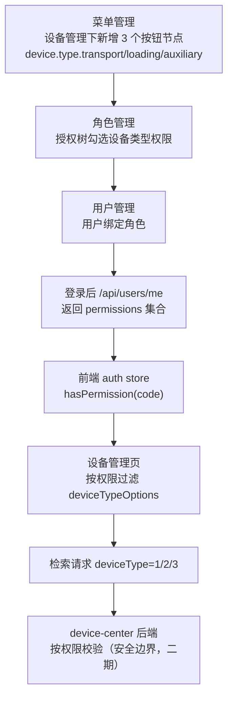

# 设备管理-设备类型下拉权限控制技术方案

## 1. 需求概述

设备管理页检索区「设备类型」下拉当前有 3 个选项：运输设备、装载设备、辅助设备。要求：

1. 在**菜单管理**中对应位置维护这 3 个下拉项（作为权限项）。
2. 在**角色管理**中给角色授予对应权限。
3. 用户拥有某设备类型权限则显示该下拉项，没有则不显示，且检索结果不包含无权限类型。

即：**菜单定义权限项 → 角色授权 → 运行态按用户权限过滤前端下拉 → 后端检索兜底校验**。

## 2. 现状分析

| 关注点 | 现状 | 位置 |
| --- | --- | --- |
| 下拉配置 | 已有集中配置，值为枚举码 1/2/3 | `src/constants/device.ts` |
| 下拉使用 | 检索区与表单均使用 `deviceTypeOptions` | `src/views/system/device.vue:76`、`:123` |
| 检索参数 | 前端已传 `deviceType`，后端已支持按枚举精确过滤 | `src/api/device.ts:47`、`DeviceManagementController` |
| 菜单权限 | 菜单支持 `DIRECTORY/MENU/BUTTON`，`permission_codes` 为逗号分隔权限编码 | `system_menus`、`menuManagement.vue` |
| 角色授权 | 角色可勾选菜单树的权限叶子，落库 `system_role_permissions` | `roleManagement.vue`、`SystemRoleService` |
| 用户资料 | `/api/users/me` 仅返回 `id/username/enabled` | `AuthController.java:108` |
| 用户与角色 | **不存在用户-角色绑定表，也没有分配入口** | `user-center-AI/schema.sql` |
| 前端权限 | **无权限 store / hasPermission / 指令** | `src/stores`、`src/router` |

结论：**配置侧（菜单/角色）已具备能力，缺的是「用户-角色绑定」和「运行态权限下发 + 前端消费」链路**。这是本方案的重点。

## 3. 总体设计



设计原则：

1. 权限编码是菜单、角色、前端配置之间的唯一约定。
2. 前端只做展示裁剪；真正的安全边界在后端接口鉴权。
3. 无权限即不展示，且不可通过手工构造请求检索到无权限类型（后端兜底）。
4. 配置可迭代：新增设备类型只需加菜单按钮 + 前端配置一项。

## 4. 权限编码设计

设备类型与权限编码一一对应，前端配置、菜单按钮、角色授权三处必须一致：

| 设备类型 | 枚举值 | 权限编码 | 菜单按钮名称（建议） |
| --- | --- | --- | --- |
| 运输设备 | `1` | `device.type.transport` | 设备类型-运输设备 |
| 装载设备 | `2` | `device.type.loading` | 设备类型-装载设备 |
| 辅助设备 | `3` | `device.type.auxiliary` | 设备类型-辅助设备 |

命令规范：`{模块}.{对象}.{动作}`，其中设备类型用 `device.type.*`，与设备管理已有 `device.manage.*` 平级。

## 5. 配置侧改造

### 5.1 菜单管理

在菜单版本 `5.20.0.0`、系统 `integrated`、父级 `device.manage` 下，新增 3 个 `BUTTON` 节点：

| 字段 | 示例（运输设备） |
| --- | --- |
| menuType | `BUTTON` |
| parentMenuCode | `device.manage` |
| menuCode | `device.manage.type-transport` |
| menuName | 设备类型-运输设备 |
| menuNameEn | Device Type - Transport |
| permissionCodes | `device.type.transport` |
| sortNo | 411 / 412 / 413 |
| visible / enabled | true |

落地方式二选一（建议同时提供）：

- **种子脚本**：在 `user-center-AI/src/main/resources/data.sql` 追加 3 条 `system_menus`（`ON CONFLICT ... DO UPDATE`），随版本可追踪。
- **界面操作**：菜单管理 → 选中「设备管理」行 → 新增 → 菜单类型选「按钮」→ 填权限编码，现有 UI 已支持，无需改代码。

> 说明：角色授权树由 `roleManagement.vue` 的 `buildPermissionTree()` 根据菜单 `permission_codes` 生成，按钮节点会自动成为「设备管理」下的可勾选叶子，无需额外开发。

### 5.2 角色管理

现有授权树已能勾选上述权限叶子，`system_role_permissions` 自动落库，**无需改代码**。

为便于验证，建议在 `data.sql` 给 `system_admin` 角色补充 3 条 `device.type.*` 权限（管理员默认拥有全部）；也可新建「设备查看员」等角色用于验证无权限场景。

## 6. 运行态权限链路（核心新增）

### 6.1 用户-角色绑定（前置缺口）

新增用户与角色的绑定关系。考虑到角色已按 `role_version_code + system_code + role_code` 唯一，建议表结构：

```sql
CREATE TABLE IF NOT EXISTS system_user_roles (
    id BIGSERIAL PRIMARY KEY,
    user_id BIGINT NOT NULL,
    role_version_code VARCHAR(80) NOT NULL,
    system_code VARCHAR(40) NOT NULL DEFAULT 'integrated',
    role_code VARCHAR(120) NOT NULL,
    created_at TIMESTAMP NOT NULL DEFAULT CURRENT_TIMESTAMP,
    CONSTRAINT uk_system_user_roles UNIQUE (user_id, role_version_code, system_code, role_code)
);
```

配套改动：

- 用户管理（`user.vue` / `UserManagementController`）增加「角色」字段，保存时写入 `system_user_roles`。
- 种子：`chenwangshan` 绑定 `system_admin`。

> 若短期不做完整绑定，可用最小临时方案：单一系统管理员用户默认拥有全部权限（`permissions = ["*"]`），先打通前端过滤，后续再补绑定与分配界面。见第 11 节。

### 6.2 后端权限下发

扩展 `/api/users/me`（推荐，前端已在 `authStore.fetchCurrentUser()` 调用），返回用户有效权限：

```json
{
  "enabled": true,
  "id": 1,
  "username": "chenwangshan",
  "roles": ["system_admin"],
  "permissions": ["device.type.transport", "device.type.loading", "device.type.auxiliary"]
}
```

- 实现：`SessionUser` / `UserProfileResponse` 增加 `roles`、`permissions`；`AuthTokenService.resolveUser` 后按 `user_id` 关联 `system_user_roles → system_role_permissions` 聚合权限编码。
- 可选新增 `GET /api/auth/permissions?systemCode=integrated`，用于不重新登录时刷新权限。

### 6.3 前端权限 store 与工具

1. `src/types/auth.ts`：`UserProfile` 增加 `permissions: string[]`、`roles: string[]`。
2. `src/stores/modules/auth.ts`：新增计算属性/方法
   ```ts
   const permissions = computed(() => new Set(profile.value?.permissions ?? []));
   function hasPermission(code: string) {
     return permissions.value.has("*") || permissions.value.has(code);
   }
   ```
3. `persistProfile` 已存在，权限随 profile 落 localStorage；登出时自动清空。
4. 可选提供全局 `v-permission` 指令或 `usePermission()` 组合式函数，供按钮级复用。

## 7. 前端设备管理改造

### 7.1 配置增加权限编码

`src/constants/device.ts`：

```ts
export type DeviceTypeOption = {
  label: string;
  value: string;
  permission?: string;
};

export const deviceTypeOptions: DeviceTypeOption[] = [
  { label: "运输设备", value: DEVICE_TYPE_ENUM.TRANSPORT, permission: "device.type.transport" },
  { label: "装载设备", value: DEVICE_TYPE_ENUM.LOADING, permission: "device.type.loading" },
  { label: "辅助设备", value: DEVICE_TYPE_ENUM.AUXILIARY, permission: "device.type.auxiliary" },
];

export function getVisibleDeviceTypeOptions(
  hasPermission: (code: string) => boolean,
): DeviceTypeOption[] {
  return deviceTypeOptions.filter((item) => !item.permission || hasPermission(item.permission));
}
```

### 7.2 页面按权限过滤

`src/views/system/device.vue`：

- 引入 `useAuthStore` 与 `getVisibleDeviceTypeOptions`。
- 计算 `visibleDeviceTypeOptions`，替换检索区下拉的 `options`（`device.vue:84`）。
- 表单「设备类型」下拉是否同样过滤：建议**同源过滤**，避免用户能创建/编辑出无权限类型；若产品要求表单可选全部，则仅过滤检索区。
- 边界：
  - 用户无任何设备类型权限：下拉为空，检索仍可只按设备编号查询；或在检索区给出「无设备类型权限」提示。
  - 编辑历史数据时当前值不在可见选项中：保留原值只读展示，避免编辑被迫改类型。

## 8. 后端检索鉴权（安全边界，建议随二期落地）

前端隐藏不是安全边界，需后端校验：

- **推荐：JWT 携带权限**。`user-center` 签发 JWT（共享密钥），`device-center` 校验签名并读取 `permissions`，`GET /api/devices` 校验 `deviceType` 是否在 `device.type.*` 许可范围内；不在则 403。
- **备选：服务间查询**。`device-center` 携带用户 token 调 `user-center /api/auth/check`，结果本地缓存（如 60s）。
- 现状 `AuthTokenService` 为服务内 token 存储，跨服务不可用，故不建议直接沿用。

若本期只做展示控制，需在方案评审中明确「暂不做后端强校验」的风险与后续排期。

## 9. 边界与异常

| 场景 | 处理 |
| --- | --- |
| 用户无任何设备类型权限 | 下拉不展示选项；仅在按设备编号检索时返回数据 |
| 权限编码在菜单中被删除但角色仍引用 | 运行态按实际授权返回；前端过滤以缺失权限视为无权限 |
| 权限下发失败/接口异常 | `authStore` 权限置空并提示，默认不展示（失败关闭，安全优先） |
| 菜单版本与角色版本不一致 | 沿用现有版本绑定校验，运行态以角色实际授权为准 |
| 手工构造 `deviceType` 请求 | 二期后端鉴权拦截；一期记录风险 |
| `permissions` 含通配符 `*` | 视为拥有全部权限 |

## 10. 测试方案

1. **配置**：菜单管理新增 3 个按钮节点；角色管理勾选并保存；`system_role_permissions` 数据正确。
2. **下发**：登录后 `/api/users/me` 返回 `permissions`；无绑定用户返回空集合。
3. **前端**：授予运输设备权限的用户，下拉仅显示「运输设备」；全授予显示 3 项；全不授予不显示；表单/检索过滤一致。
4. **检索**：选择可见类型能正确命中（如 `deviceType=1` 返回 DEV-1002）。
5. **安全（二期）**：无权限用户直接调用 `GET /api/devices?deviceType=2` 返回 403。
6. **回归**：`vue-tsc`/`pnpm build` 通过；device-center 编译通过。

## 11. 实施步骤与工作量

| 阶段 | 内容 | 预估 |
| --- | --- | --- |
| P0 配置 | 菜单种子 + 角色授权种子 + 管理员权限种子 | 0.5d |
| P1 绑定 | `system_user_roles` 表、用户管理角色字段、种子绑定 | 1.5d |
| P2 下发 | `/api/users/me` 返回 permissions（聚合查询） | 1d |
| P3 前端 | auth store 权限、配置 permission 字段、device 过滤 | 1d |
| P4 鉴权（可选） | device-center 校验 + JWT/服务间校验 | 2d |
| P5 测试 | 单元/集成/端到端 | 1d |

**最小可用路径（P0+P2 简化 + P3）**：若暂不做用户-角色绑定，可让 `chenwangshan` 登录后直接返回全部 `permissions = ["*"]`，先用前端过滤打通链路，再补 P1。此路径约 2 天。

## 12. 待确认问题

| 编号 | 问题 | 建议默认 |
| --- | --- | --- |
| Q1 | 表单下拉是否也按权限过滤 | 是，与检索区同源 |
| Q2 | 无任何设备类型权限时的交互 | 下拉置空 + 可仅按设备编号检索 |
| Q3 | 是否本期做后端强校验 | 否，二期；先记录风险 |
| Q4 | 权限绑定粒度 | 用户直接绑角色（`system_user_roles`） |
| Q5 | 是否需要按矿区（mineAreas）进一步收窄设备类型 | 否，本期只按角色权限 |
| Q6 | 新增设备类型是否要免开发 | 预留：前端配置 + 菜单按钮两步；如需全动态可改为从菜单接口读取 |
